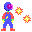

<h1 align="center">Adventures of Captain Comic (Linux/Windows)</h1>

Кроссплатформенный порт культовой DOS-аркады **«Приключения Капитана Комика»** (*Adventures of Captain Comic*, Rev 5, Майкл Денио, 1988), написанный в ноябре 2026 г. Максимом Живлюком, без использования сторонних игровых движков.

Стек проекта: **C11 + SDL2 + SDL2_ttf + SDL2_image**, компилятор — **GCC 15.2.0**.

Станьте отважным космическим героем Капитаном Комиком и отправьтесь в опасную экспедицию на загадочную планету **Тамби**!

Вас ждёт большое приключение, охватывающее 8 взаимосвязанных локаций, которые складываются в 24 бесшовных игровых экрана.

Чтобы выжить в этом враждебном мире, вам предстоит отыскать немало полезного снаряжения: от заряжающих оружие банок Бластер-колы и прыжковых ботинок до жезла телепортации и спасительного фонаря.

Проложите свой путь через орды из 14 видов уникальных инопланетных существ, разгадайте секреты планеты и верните три похищенные королевские реликвии: **Самоцветы**, **Мешок золота** и легендарную **Корону Эпох**.

Этот порт создан с глубоким уважением к классике, и с ювелирной точностью воссоздаёт дух оригинала:

* **Аутентичная картинка и звук:** бережно перенесённая 4-плоскостная EGA-графика с оригинальными пропорциями пикселей эпохи DOS (6:5) сочетается с честным синтезом звука PC Speaker, работающим по тем самым таблицам частот.
* **Точность и современная плавность:** вся игровая физика и искусственный интеллект противников из эталонной пятой ревизии (Revision 5) работают как часы в современном и сверхплавном цикле 120 Гц.
* **Комфорт и доступность:** игра дополнена полной русской локализацией, переработанной информативной верхней панелью и удобной архитектурой, позволяющей собрать весь проект в единый исполняемый файл со встроенными ресурсами для Linux и Windows x64.
