<p align="center">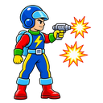</p>
<h1 align="center">Adventures of Captain Comic</h1>
<h3 align="center">(Linux / Windows / Web)</h3>
<br>

Современное кроссплатформенное переиздание культового DOS-платформера **«Приключения Капитана Комика»** ([*The Adventures of Captain Comic*](https://en.wikipedia.org/wiki/The_Adventures_of_Captain_Comic), Rev 5, *Майкл Денио*, 1988).

**The Adventures of Captain Comic** (более известная как просто Captain Comic) — видеоигра, созданная Майклом Денио и выпущенная в 1988 году для ПК по модели shareware (условно-бесплатно).

В 1990 году вышел порт этой игры на NES, который сильно отличается от ПК-версии.

> Станьте отважным космическим рейнджером, **Капитаном Комиком**, и держите курс к таинственной планете <span class="ega-light-magenta">*Тамби*</span>, полной неизведанных угроз!
>
> Впереди вас ждёт большое приключение, объединяющее 8 обширных локаций и 24 бесшовные игровые зоны.
>
> Выжить в этом суровом мире поможет снаряжение, спрятанное в самых разных его уголках: от усиливающих бластер банок **Бластер-колы** и прыжковых **Ботинок** до **Жезла телепортации** и спасительного **Фонаря**.
>
> Одолейте орды из 14 видов причудливых инопланетных существ, раскройте секреты планеты и верните три похищенные королевские реликвии: <span class="yellow">*Мистические самоцветы*</span>, <span class="yellow">*Мешок золота*</span> и легендарную <span class="yellow">*Корону Эпох*</span>.

Современная версия игры создана **Максимом Живлюком** в ноябре 2026 года без использования сторонних игровых движков.

**Стек проекта:** C11, SDL2, SDL2_ttf, SDL2_image; компилятор — **GCC 15.2.0**.

В этом порте глубокое почтение к классике сочетается с бережным вниманием к каждой детали оригинала:

- **Аутентичная картинка и звук:** бережно перенесённая 4-плоскостная EGA-графика с оригинальными пропорциями пикселей эпохи DOS (`6:5`) сочетается с честным синтезом звука PC Speaker, работающим по оригинальным таблицам частот.
- **Точность и современная плавность:** игровая физика и искусственный интеллект противников из эталонной пятой ревизии (*Revision 5*) работают в современном сверхплавном цикле 120 Гц.
- **Комфорт и доступность:** игра дополнена полной русской локализацией, переработанной информативной верхней панелью и удобной архитектурой, позволяющей собрать проект в единый исполняемый файл со встроенными ресурсами для Linux и Windows x64.

**Теперь и в браузере:** [играть в веб-версию](https://captain-comic.ru). Благодаря WebAssembly игра запускается прямо на странице без установки, сохраняя графику, физику и звук версии на C11 / SDL2. Управление осуществляется с клавиатуры, а кнопки под игровым полем позволяют открыть справку и настройки, переключить звук, пополнить щит или перейти в полноэкранный режим. При переключении на другую вкладку игра автоматически ставится на паузу. Рекорды и настройки клавиш сохраняются в браузере и восстанавливаются после перезагрузки страницы.

## Основные возможности

### Графика, интерфейс и русификация

Иконки интерфейса хранятся в `assets/icons/hud-icons.png`. Круглые иконки жизней отрисовываются отдельно (строго **32×32 пикселя окна** с промежутком **8 пикселей**) без тёмной каймы и наложения соседних элементов. При узком окне оставшийся запас жизней отображается числом `+N`.

- **Аутентичная графика EGA:** оригинальные 4-плоскостные спрайты, тайлы и анимации эффектов с сохранением классических пропорций пикселей DOS (`6:5`).
- **Обновлённая верхняя панель (HUD) и сглаженный шрифт:**
  - *верхний ряд* — анимированный механический счётчик и 9-значный индикатор очков, счётчик банок колы (`0/5`), заголовок игры, иконка и название локации, индикатор текущей панорамы (`1/3`, `2/3`, `3/3`) со схемой трёх экранов;
  - *нижний ряд* — шкалы оружия и щита, запасные жизни и 8 слотов инвентаря;
  - весь текст рендерится в нативном разрешении окна шрифтом *Magistral Cond Medium*.
- **Полная русская локализация:**
  - три стартовые заставки (включая русифицированную сюжетную страницу, а также справочник предметов и обитателей планеты Тамби);
  - внутриигровые плашки паузы, завершения игры, финала и **6-страничная справка (`F1`)** с анимированным бестиарием;
  - **таблица 10 лучших результатов** с вводом имени на русском языке (`scores.dat`).
### Игровой процесс, физика и звук

- **Все 8 локаций и 24 панорамы** (Скалистый лес, Озеро Сири, Пещера слепых жаб, Ангар, Космическая база, Луна Тамби, Комплекс, Замок) с оригинальными координатами предметов, дверей и телепортов из `dos/world.json`.
- **Физика 120 Гц и ИИ Revision 5:** переменная высота прыжка, лунная гравитация, 14 видов противников и 5 режимов их поведения.
- **Оригинальная механика оружия и снаряжения:** до 5 одновременных выстрелов в зависимости от банок колы, 12-сегментная шкала энергии, очередь быстрых нажатий огня, ключ, ботинки, штопор, фонарь, жезл телепортации и три сокровища.
- **Синтез звука PC Speaker:** оригинальные таблицы делителей PIT и длительностей эффектов *Revision 5* (выстрел, попадание, урон, гибель, подбор предметов, двери, телепортация, мелодия вступления и перехода между панорамами) с приоритетами каналов.

### Встроенное меню настроек и отладки (`F4`)

Четырёхстраничное меню (`Tab` / `PgUp` / `PgDn`) с заморозкой игрового мира:

1. **Локации (1/4):** выбор стрелками `↑` / `↓`, подтверждение `Enter`, `Num Enter` или `Пробелом`; `Home` / `End` — переход в начало или конец списка. Цифры `1`–`8` мгновенно переносят ко входу в выбранную локацию с сохранением снаряжения. При открытии выделена текущая локация.
2. **Герой и инвентарь (2/4):** изменение числа жизней (`0–99`), банок колы (`0–5`), энергии щита (`0–6`), а также включение и выключение предметов и сокровищ.
3. **Клавиши (3/4):** переназначение всех игровых действий (до 3 клавиш на действие, работа по физическим скан-кодам независимо от раскладки, автосохранение в `keys.cfg`).
4. **Таблица рекордов (4/4):** просмотр и редактирование 10 лучших результатов (`scores.dat`) непосредственно во время игры.

## Управление

| Клавиша | Действие |
| :--- | :--- |
| **`Enter` / `Пробел` / `→`** | Листать заставки вперёд; на 3-й странице — начать игру |
| **`←` / `Backspace`** | Предыдущая страница заставки |
| **`R`** *(на заставке)* | Просмотр таблицы рекордов |
| **`←` / `→` / `A` / `D`** | Движение влево / вправо |
| **`Пробел` / `↑`** | Прыжок (удержание увеличивает высоту) |
| **`Ins` / `Num 0` / `X`** | Стрельба |
| **`Alt` / `E`** | Войти в дверь (при наличии ключа) |
| **`Caps Lock` / `T`** | Телепортация (при наличии жезла телепортации) |
| **`Esc` / `P`** | Пауза (`Q` / `Й` на паузе — выход из игры) |
| **`F1`** | Справка (`←` / `→` или `PgUp` / `PgDn` — переключение страниц) |
| **`F2`** | Включить / выключить звук |
| **`F3`** | Подсветка контуров твёрдых блоков |
| **`F4`** | Меню локаций, параметров героя, клавиш и рекордов |
| **`F5`** | Восстановить энергию щита до максимума (6 делений) |
| **`F11`** | Полноэкранный режим |

## Локации

| № | Иконка | Название | English | Файлы уровня |
| :---: | :---: | :--- | :--- | :--- |
| 1 |  | Скалистый лес | Forest | `forest` |
| 2 |  | Озеро Сири | Lake | `lake` |
| 3 | 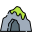 | Пещера слепых жаб | Cave | `cave` |
| 4 |  | Ангар | Shed | `shed` |
| 5 |  | Космическая база | Base | `base` |
| 6 |  | Луна Тамби | Moon | `space` |
| 7 |  | Комплекс | Comp | `comp` |
| 8 |  | Замок | Castle | `castle` |

> Названия и порядок локаций в меню одинаковы в игре и редакторе. Для Луны сохранено исходное имя файлов `space` — переименовывать карты не требуется.

## Предметы: 10 видов

| Иконка | Предмет | Где искать | Назначение |
| :---: | :--- | :--- | :--- |
| 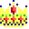 | **Корона Эпох** (*Crown of the Ages*) | Замок (Castle), 1-й экран | Главное сокровище; в этом порте запускает финал. |
| 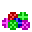 | **Самоцветы** (*Gems*) | Луна Тамби (Moon), 3-й экран | Главное сокровище. |
| 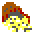 | **Мешок золота** (*Gold*) | Пещера слепых жаб (Cave), 2-й экран | Главное сокровище. |
|  | **Ключ от двери** (*Door Key*) | Скалистый лес (Forest), 3-й экран | Открывает запертые двери. |
|  | **Штопор** (*Corkscrew*) | Космическая база (Base), 2-й экран | Огненные шары летят по синусоиде (волне). |
|  | **Ботинки** (*Boots*) | Космическая база (Base), 3-й экран | Увеличивают высоту прыжка. |
| 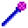 | **Жезл телепортации** (*Teleport Wand*) | Пещера слепых жаб (Cave), 3-й экран | Позволяет телепортироваться. |
| 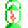 | **Фонарь** (*Lantern*) | Комплекс (Comp / Tube), конец 3-го экрана | Освещает тёмные помещения. |
|  | **Бластер-кола** (*Blastola Cola*) | Пять банок (расположение ниже) | Даёт оружие и увеличивает число одновременных выстрелов до пяти. |
| 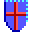 | **Щит** (*Shield*) | Встречается в разных локациях | Восстанавливает энергию щита; при полной шкале даёт дополнительную жизнь. |

- **Главные сокровища:** Корона Эпох, Самоцветы, Мешок золота.
- **Снаряжение и улучшения:** Ключ, Штопор, Ботинки, Жезл телепортации, Фонарь.
- **Оружие и восстановление:** Бластер-кола и Щит.

> В текущем порте взятие **Короны Эпох** запускает пересчёт оставшихся жизней в очки и финал, даже если остальные сокровища не собраны. В `assets/dos/world.json` золото размещено во 2-й панораме пещеры, а жезл телепортации — в 3-й.
### Пять банок Бластер-колы

1. **Скалистый лес (Forest)**, 1-й экран — прямо на старте.
2. **Озеро Сири (Lake)**, 1-й экран.
3. **Озеро Сири (Lake)**, 3-й экран — перед входом в шаттл.
4. **Луна Тамби (Moon)**, 1-й экран.
5. **Ангар (Shed)**, 2-й экран.

> Дополнительная жизнь также начисляется за каждое найденное сокровище и каждые 50 000 очков. Пять банок колы — это пять экземпляров одного вида предмета.

### Все щиты (Shields): 11 экземпляров

<p>
  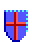
  &nbsp;&nbsp;<strong>Щит</strong> восстанавливает энергию до полной шкалы.<br>
  &nbsp;&nbsp;Если шкала уже полная, подбор щита даёт дополнительную жизнь (с учётом игрового лимита жизней).
</p>

В `assets/dos/world.json` задано **11 щитов в 8 локациях** (в Ангаре, Комплексе и Замке — по два, в остальных пяти локациях — по одному):

| № | Локация | Экран | Ориентир | Координаты (x, y) |
| :---: | :--- | :---: | :--- | :---: |
| 1 | **Скалистый лес (Forest)** | 2 | Около середины панорамы, на уступе у разрыва между платформами. | `944, 80` |
| 2 | **Озеро Сири (Lake)** | 2 | Правее середины панорамы, на высокой платформе над водой. | `1424, 80` |
| 3 | **Луна Тамби (Moon)** | 2 | В первой половине панорамы, на коричневой платформе над поверхностью. | `912, 64` |
| 4 | **Космическая база (Base)** | 1 | У самого правого края, на верхнем уровне; от входа нужно идти направо. | `2016, 32` |
| 5 | **Пещера слепых жаб (Cave)** | 1 | На высоком уступе в левой части, рядом с внутренней дверью пещеры. | `328, 48` |
| 6 | **Ангар (Shed)** | 1 | За высокой стеной в правой части; для прохода пригодится телепорт. | `1296, 96` |
| 7 | **Ангар (Shed)** | 3 | В конце панорамы, справа от двери в Комплекс. | `1968, 80` |
| 8 | **Комплекс (Comp)** | 1 | Под потолком, на верхней платформе над большим разрывом; доступ через верхние платформы и телепортацию. | `1120, 16` |
| 9 | **Комплекс (Comp)** | 2 | В первой трети панорамы, на среднем уровне у края горизонтальной платформы. | `560, 80` |
| 10 | **Замок (Castle)** | 2 | В первой трети панорамы, на нижнем уровне. | `528, 112` |
| 11 | **Замок (Castle)** | 3 | В начале панорамы, на среднем уровне перед книжными шкафами текущей карты. | `352, 64` |

- Координаты указаны в пикселях относительно левого верхнего угла отдельной панорамы (`2048×160`).
- Экраны 1–3 соответствуют файлам `0.PT`–`2.PT`.

## Бестиарий (противники)

| Иконка | Название врага | Перевод / Описание | Где встречается |
| :---: | :--- | :--- | :--- |
|  | **Space Pollen** | Космическая пыльца | Луна Тамби (Moon) |
|  | **Saucer** | Летающая тарелка | Луна Тамби (Moon) |
| 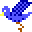 | **Brave Bird** | Храбрая птица | Скалистый лес, Ангар, Замок |
|  | **Shy Bird** | Пугливая птица (атакует со спины) | Скалистый лес (Forest) |
| 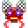 | **Bug-Eyes** | Пучеглаз (прыгает по земле) | Озеро Сири (Lake) |
|  | **Fireball** | Огненный шар | Озеро Сири (Lake) |
|  | **Glow Globe** | Светящийся шар (катится по полу) | Космическая база (Base) |
|  | **Blind Toad** | Слепая жаба | Пещера слепых жаб (Cave) |
|  | **Killer Bee** | Пчела убийца | Пещера слепых жаб, Ангар, Замок |
|  | **Beach Ball** | Пляжный мяч | Ангар, Замок |
| 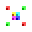 | **Atom** | Атом | Комплекс (Comp / Tube) |
|  | **Spark** | Искра | Комплекс (Comp / Tube) |
|  | **F.W. Bros.** | Братья фейерверки | Комплекс (Comp / Tube) |
|  | **Spinner** | Спиннер (атакует, когда герой отвернулся) | Замок (Castle) |

## Хранение настроек и рекордов

Таблица рекордов (`scores.dat`) и настройки клавиш (`keys.cfg`) в первую очередь сохраняются в подкаталог **`data/`** рядом с исполняемым файлом (портативный режим). Если создать каталог `data/` и записать в него файлы невозможно, используются системные директории пользователя:

- **Linux:** `~/.local/share/CaptainComicLinux/CaptainComic/` (с учётом переменной `XDG_DATA_HOME`);
- **Windows:** `%APPDATA%\CaptainComicWin\CaptainComic\`.

## Сборка и запуск

### Зависимости (Debian / Ubuntu / Kubuntu)

- **Для сборки под Linux:** `gcc`, `make` (4.3+), `pkg-config`, `python3`, `libsdl2-dev`, `libsdl2-ttf-dev`, `libsdl2-image-dev`.
- **Для сборки под Windows x64:** `mingw-w64` (`x86_64-w64-mingw32-gcc`) и SDK в `deps/win32/sysroot/`.
- **Для Linux standalone:** статические библиотеки в `deps/linux/` и системные зависимости Linux (`mingw-w64` не требуется).
- **Для архивов `.7z`:** `p7zip-full` (команда `make dist-7z`).
- **Для пересборки локальных Linux-библиотек:** `cmake`, `libfreetype-dev`, `libharfbuzz-dev`, `libpng-dev`, `libjpeg-dev`, `libbz2-dev`.

Установка базовых пакетов в Debian / Ubuntu:

```bash
sudo apt install gcc make pkg-config python3 libsdl2-dev libsdl2-ttf-dev libsdl2-image-dev
```

### Цели `Makefile`

| Команда | Результат | Описание |
| :--- | :--- | :--- |
| `make` *(или `make linux`)* | `captain-comic` | Обычная сборка для текущей Linux-системы |
| `make all` | 4 варианта | Сборка всех вариантов для Linux и Windows (обычные и со встроенными ресурсами) |
| `make linux` | `captain-comic` | Динамическая сборка под Linux (системные SDL2-библиотеки и внешний пакет ресурсов) |
| `make linux-standalone` | `captain-comic-standalone` | ELF со статическими SDL2, SDL2_ttf, SDL2_image и встроенными ресурсами; системные библиотеки остаются динамическими |
| `make static` | `captain-comic-static` | Совместимое имя для копии `captain-comic-standalone` (повторная компиляция не выполняется) |
| `make win` | `captain-comic.exe` + `data/*.dll` | Сборка под Windows x64 с отложенной загрузкой DLL из `data/` и вшитой иконкой |
| `make win-standalone` | `captain-comic-standalone.exe` | Единый автономный `.exe` под Windows x64 со статическим SDL2 и вшитыми ресурсами |
| `make data/assets.pak` | `data/assets.pak` | Упаковка каталога `assets/` в сжатый ZIP-архив ресурсов (`miniz`) |
| `make src/assets_data.h` | `src/assets_data.h` | Генерация C-массива `assets_pak` из `data/assets.pak` для standalone-сборок |
| `make dist` | Архивы в `dist/` | Сборка 4 вариантов и упаковка 5 дистрибутивов (`.tar.gz` для Linux и `.zip` для Windows) с документацией в `doc/` |
| `make dist-7z` | Архивы `.7z` в `dist/` | Сборка и упаковка дистрибутивов со сжатием Windows-сборок в `.7z` (алиас `make dist WIN_FMT=7z`) |
| `make web` | `build/web/` | Браузерная сборка WebAssembly через Emscripten |
| `make web-docs` | Документация в `build/web/` | Копирование локального README, справочных страниц и изображений без запуска Emscripten |
| `make web-serve` | Локальный сервер | Сборка веб-версии и запуск на `http://127.0.0.1:8080` |
| `make check` | Отчёт проверок | Сборка `linux` и запуск встроенного набора сценариев (`./captain-comic --self-test`) |
| `make check-input` | Проверка ввода | Реальный цикл SDL: короткие нажатия, движение, прыжок и стрельба |
| `make check-ending` | Проверка финала | Реальные события SDL: корона → пересчёт → заставка → ввод имени → таблица → выход |
| `make check-resources` | Проверка ресурсов | Каталог, внешний PAK, приоритет `--assets` и отклонение повреждённых ресурсов |
| `make clean` | — | Очистка артефактов сборки, дистрибутивов и генерируемых ресурсов (`keys.cfg` и `scores.dat` сохраняются) |

> **Примечание:** обе Linux-цели `linux-standalone` и `static` не являются полностью статическими — им по-прежнему требуются `glibc`, системные звуковые и оконные библиотеки. Цель `static` сохранена только для обратной совместимости.

Сборка инкрементальная; варианты используют отдельные объектные файлы, поэтому поддерживается многопоточная сборка (`make -j4 all`). После изменения флагов компилятора выполните `make clean`. Генерация `assets.pak` воспроизводима и учитывает удаление файлов. Игровой бинарник содержит только распаковку ZIP; упаковку выполняет скрипт `tools/pack_assets.py`.

Пересборка Linux-зависимостей из включённых исходников (при необходимости):

```bash
sh deps/linux/deps.sh
```

### Быстрый старт (Linux)

```bash
make linux
./captain-comic
```
### Браузерная версия (WebAssembly)

Игра собирается из той же кодовой базы C11 / SDL2 с помощью **Emscripten** (проверена сборка на версии `7.0.0`). Для сборки требуются активированное окружение `emsdk`, `make` и Python 3; системные библиотеки SDL2 не нужны.

1. **Установите `emsdk`** один раз (официальная [инструкция Emscripten](https://emscripten.org/docs/index.html)):

```bash
git clone https://github.com/emscripten-core/emscripten.git "$HOME/emsdk"
"$HOME/emsdk/emsdk" install 7.0.0
"$HOME/emsdk/emsdk" activate 7.0.0
```

2. **Подключите окружение и соберите проект** в каталоге игры:

```bash
source "$HOME/emsdk/emsdk_env.sh"
emcc --version
make web
make web-serve
```

> Команду `source` необходимо выполнять в каждом новом окне терминала (если `emsdk` установлен в другой каталог, укажите свой путь). Чтобы не делать этого вручную при каждом запуске, добавьте вызов в конец файла `~/.bashrc` и примените изменения:
>
> ```bash
> echo 'source "$HOME/emsdk/emsdk_env.sh"' >> ~/.bashrc
> source ~/.bashrc
> ```
>
> Ошибка `emcc: Нет такого файла или каталога` означает, что компилятор не установлен или не добавлен в `PATH`.

Откройте `http://127.0.0.1:8080` и нажмите **Играть**. Результат сборки помещается в `build/web/`: содержимое этого каталога можно разместить на любом статическом HTTP/HTTPS-хостинге (открытие `index.html` локально через протокол `file://` не поддерживается).

**Особенности веб-версии:**
- **Управление и звук:** рассчитано на клавиатуру; звук активируется после нажатия кнопки **Играть**, а при переключении на другую вкладку игра автоматически ставится на паузу.
- **Сохранения:** рекорды и настройки клавиш хранятся в локальном хранилище браузера (`localStorage`) для текущего домена и очищаются только при сбросе данных сайта (текущая игровая сессия не сохраняется).
- **Встроенная документация:** кнопка **README ↗** открывает локальную справку в новой вкладке. Все файлы документации, прохождение и иллюстрации собираются из актуальных Markdown-файлов при каждой сборке (обновить только документацию без пересборки кода можно командой `make web-docs`).
- **Публикация:** загрузите на сервер **всё содержимое `build/web/`**, включая `readme.html`, `readme.js`, `readme.css`, `README.md`, а также каталоги `doc/` и `vendor/`. Все зависимости включены в сборку; CDN и серверная логика не требуются.

### Версии для Windows x64

Кросс-сборка из Linux выполняется через **MinGW-w64** (`x86_64-w64-mingw32-gcc`) с вшиванием иконки (`src/icon.rc` → `assets/icons/icon.ico`) и флагом `-mwindows` (оконное приложение без консоли):

- **Обычная (`make win` → `captain-comic.exe` + `data/`):** использует отложенную загрузку DLL (`delayimp` + `tools/make_delaylib.py`), поэтому в корне лежит только исполняемый файл, а все `.dll` и `assets.pak` находятся в подкаталоге `data/`.
- **Автономная (`make win-standalone` → `captain-comic-standalone.exe`):** единый самодостаточный `.exe` со статическим SDL2 и вшитыми ресурсами (`src/assets_data.h`), не требующий внешних библиотек и папок.

## Параметры командной строки

```bash
./captain-comic --version                      # показать версию сборки
./captain-comic --area lake --segment 1        # старт в выбранной локации (сегменты 0..2)
./captain-comic --assets /path/to/assets       # указать путь к каталогу или PAK-файлу ресурсов
./captain-comic --self-test                    # запустить встроенные проверки физики, карт и логики
./captain-comic --headless --frames 10 --screenshot /tmp/shot.bmp
```

### Поиск ресурсов, финал и редактор рекордов

- **Загрузка ресурсов:** обычная сборка ищет `data/assets.pak`, затем каталог `assets/` рядом с бинарником; `standalone`-версия по умолчанию использует встроенный пакет. Явный флаг `--assets PATH` в обоих случаях принудительно загружает только указанный каталог или PAK-файл. Поиск внутри архива и каталога регистронезависимый (все имена в `assets/dos/` приведены к нижнему регистру).
- **Логика финала:** получение **Короны Эпох** сразу запускает финал независимо от остальных сокровищ и снаряжения. Оставшиеся жизни конвертируются в очки (`1000` за жизнь), после чего отображается финальная заставка и таблица рекордов.
- **Редактор рекордов (`F4`, страница 4):**
  - `↑` / `↓` — выбор записи, ввод текста и `Backspace` — изменение имени (до 16 символов UTF-8);
  - `←` / `→` — изменение очков на `1000` (с `Shift` — на `10 000`, с `Ctrl` — на `100 000`; диапазон `1–999 999 999`), после чего таблица автоматически пересортировывается;
  - `Ins` (`Num 0` при выключенном Num Lock) — добавить запись, `Del` (`Num .` при выключенном Num Lock) — удалить запись.

## Структура проекта

- `src/main.c` — инициализация SDL2, главный цикл 120 Гц, разбор аргументов CLI, полноэкранный режим.
- `src/engine.c` — физика движения, прыжки, коллизии, двери, телепорты и ИИ противников.
- `src/input.c` — обработка ввода, очередь быстрых выстрелов, переназначение клавиш.
- `src/resources.c` — загрузка бинарных ресурсов (`.PT`, `.TT2`, `.SHP`, `.SPR`, `dos/world.json`) напрямую в память через `miniz`.
- `src/render.c` — отрисовка игрового поля, HUD, заставок, меню `F4` и справки `F1`.
- `src/sound.c` / `src/sound_data.h` — синтез звука PC Speaker по таблицам PIT *Revision 5*.
- `src/scores.c` — таблица рекордов, встроенный редактор и ввод имён на русском языке.
- `src/save.c` — атомарная перезапись файлов сохранения с учётом различий POSIX и Windows.
- `src/tests.c` — встроенные сценарии самопроверки.
- `src/cc.h` / `src/miniz.c` / `src/miniz.h` / `src/assets_data.h` — общие структуры, распаковщик архивов и вшитые ресурсы.
- `web/` — веб-обёртка для сборки WebAssembly, стили и панель управления в браузере.
- `assets/` — игровые уровни и графика (`dos/`), заставки (`intro/`), иконки (`icons/`) и шрифт (`fonts/`).
- `doc/` — документация (`README.md`, `WALKTHROUGH.md`, `CHANGELOG.md`, `AUDIT.md`), иллюстрации (`doc/images/`) и материалы зависимостей.
- `data/` — упакованный пакет `assets.pak`, рантайм-библиотеки Windows (`.dll`) и портативные сохранения (`scores.dat`, `keys.cfg`).
- `deps/` — локальные статические зависимости (`deps/linux/`) и sysroot для MinGW-w64 (`deps/win32/sysroot/`).
- `tools/` — вспомогательные скрипты сборки (`pack_assets.py`, `dist.py`, `make_delaylib.py`, автотесты ввода и ресурсов).

## Происхождение и благодарности

- **Оригинальная игра:** [*The Adventures of Captain Comic*](https://en.wikipedia.org/wiki/The_Adventures_of_Captain_Comic) (Revision 5), Michael A. Denio (1988).
- **Формат панорам и редактор уровней:** восстановлены с помощью [**PANED 2.05**](https://github.com/bigvax/paned) (Max Zhivluck, 1990–1991).

## Документация и автор

- История версий и изменений: [CHANGELOG.md](doc/CHANGELOG.md).
- Технические проверки и их результаты: [AUDIT.md](doc/AUDIT.md).
- Прохождение игры: [WALKTHROUGH.md](doc/WALKTHROUGH.md)
- Справочные материалы: [Страница игры на Wikipedia](https://en.wikipedia.org/wiki/The_Adventures_of_Captain_Comic).
- Автор: **Максим Живлюк**: [bigvax.ru](http://bigvax.ru), [bigvax@mail.ru](mailto:bigvax@mail.ru).
