<p align="center">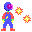</p>

<h1 align="center">Adventures of Captain Comic (Linux / Windows / Web)</h1>

<br>

Кроссплатформенный порт культовой DOS-аркады **«Приключения Капитана Комика»** (*Adventures of Captain Comic*, Rev 5, Майкл Денио, 1988), написанный в ноябре 2026 г. Максимом Живлюком, без использования сторонних игровых движков.

Стек проекта: **C11 + SDL2 + SDL2_ttf + SDL2_image**, компилятор — **GCC 15.2.0**.

Станьте отважным космическим героем Капитаном Комиком и отправьтесь в опасную экспедицию на загадочную планету **Тамби**!

Вас ждёт большое приключение, охватывающее 8 взаимосвязанных локаций, которые складываются в 24 бесшовных игровых экрана.

Чтобы выжить в этом враждебном мире, вам предстоит отыскать немало полезного снаряжения: от заряжающих оружие банок Бластер-колы и прыжковых ботинок до жезла телепортации и спасительного фонаря.

Проложите свой путь через орды из 14 видов уникальных инопланетных существ, разгадайте секреты планеты и верните три похищенные королевские реликвии: **Самоцветы**, **Мешок золота** и легендарную **Корону Эпох**.

Этот порт создан с глубоким уважением к классике, и с ювелирной точностью воссоздаёт дух оригинала:

* **Аутентичная картинка и звук:** бережно перенесённая 4-плоскостная EGA-графика с оригинальными пропорциями пикселей эпохи DOS (6:5) сочетается с честным синтезом звука PC Speaker, работающим по тем самым таблицам частот.
* **Точность и современная плавность:** вся игровая физика и искусственный интеллект противников из эталонной пятой ревизии (Revision 5) работают как часы в современном и сверхплавном цикле 120 Гц.
* **Комфорт и доступность:** игра дополнена полной русской локализацией, переработанной информативной верхней панелью и удобной архитектурой, позволяющей собрать весь проект в единый исполняемый файл со встроенными ресурсами для Linux и Windows x64.

**Теперь и в браузере:** [играть в веб-версию](https://captain-comic-browser.baltexpo-8341.chatgpt.site/). Игра работает через WebAssembly, управление — с клавиатуры; рекорды и настройки сохраняются в браузере.

---

- История версий и изменений: [CHANGELOG.md](CHANGELOG.md).
- Технические проверки и их результаты: [AUDIT.md](AUDIT.md).
- Справочные материалы: [Прохождение](WALKTHROUGH.md), [руководство DOS-версии](https://www.retrogames.cz/manualy/DOS/Captain_Comic_-_DOS_-_Manual.pdf).

## Основные возможности

### Графика, интерфейс и русификация

Иконки интерфейса хранятся в `assets/icons/hud-icons.png`. Круглые иконки жизней
отрисовываются отдельно, строго **32×32 пикселя окна**, с промежутком **8 пикселей**,
без тёмной каймы и примеси соседних иконок. При узком окне оставшийся запас
жизней показывается числом `+N`, чтобы не уменьшать и не накладывать значки.

- **Аутентичная графика EGA:** оригинальные 4-плоскостные спрайты, тайлы и анимации эффектов с сохранением классических пропорций пикселей DOS (`6:5`).
- **Обновлённая верхняя панель (HUD) и сглаженный шрифт:**
  - верхний ряд — анимированный механический счётчик и 9-значный индикатор очков, счётчик банок колы (`0/5`), заголовок игры, иконка и название локации, индикатор текущей панорамы (`1/3`, `2/3`, `3/3`) со схемой трёх экранов;
  - нижний ряд — шкалы оружия и щита, запасные жизни и 8 слотов инвентаря;
  - весь текст рендерится в нативном разрешении окна шрифтом *Magistral Cond Medium*.
- **Полная русская локализация:**
  - три стартовые заставки (включая русифицированные сюжетную страницу и справочник предметов и обитателей планеты Тамби);
  - внутриигровые плашки паузы, завершения игры, финала и **6-страничная справка (`F1`)** с анимированным бестиарием;
  - **таблица 10 лучших результатов** с вводом имени на русском языке (`scores.dat`).

### Игровой процесс, физика и звук
- **Все 8 локаций и 24 панорамы** (Скалистый лес, Озеро Сири, Пещера слепых жаб, Ангар, Космическая база, Луна Тамби, Комплекс, Замок) с оригинальными координатами предметов, дверей и телепортов из `dos/world.json`.
- **Физика 120 Гц и ИИ Revision 5:** переменная высота прыжка, лунная гравитация, 14 видов противников и 5 режимов их поведения.
- **Оригинальная механика оружия и снаряжения:** до 5 одновременных выстрелов в зависимости от банок колы, 12-сегментная шкала энергии, очередь быстрых нажатий огня, ключ, ботинки, штопор, фонарь, жезл телепортации и три сокровища.
- **Синтез звука PC Speaker:** оригинальные таблицы делителей PIT и длительностей эффектов Revision 5 (выстрел, попадание, урон, гибель, подбор предметов, двери, телепортация, мелодия вступления и перехода между панорамами) с приоритетами каналов.

### Встроенное меню настроек и отладки (`F4`)
Четырёхстраничное меню (`Tab` / `PgUp` / `PgDn`) с заморозкой игрового мира:

- **Локации (1/4):** выбор стрелками ↑/↓, подтверждение Enter, Num Enter или Пробелом; Home/End — начало/конец списка. Цифры 1–8 сразу переносят ко входу в локацию с сохранением снаряжения. При открытии выделена текущая локация.
- **Герой и инвентарь (2/4):** изменение числа жизней (0–99), колы (0–5), энергии щита (0–6), включение/выключение предметов и сокровищ.
- **Клавиши (3/4):** переназначение всех игровых действий (до 3 клавиш на действие, работа по физическим скан-кодам независимо от раскладки, автосохранение в keys.cfg).
- **Таблица рекордов (4/4):** просмотр и редактирование 10 лучших результатов (scores.dat) непосредственно во время игры.

---
## Управление

&nbsp;

| Клавиша | Действие |
| :--- | :--- |
| **`Enter` / `Пробел` / `→`**&nbsp;&nbsp; | Листать заставки вперёд; на 3-й странице — начать игру |
| **`←` / `Backspace`** | Предыдущая страница заставки |
| **`R`** *(на заставке)* | Просмотр таблицы рекордов |
| **`←` / `→` / `A` / `D`** | Движение влево / вправо |
| **`Пробел` / `↑`** | Прыжок (удержание увеличивает высоту) |
| **`Ins` / `Num 0` / `X`** | Стрельба |
| **`Alt`, `E`** | Войти в дверь (при наличии ключа) |
| **`Caps Lock` / `T`** | Телепортация (при наличии жезла телепортации) |
| **`Esc` / `P`** | Пауза (`Q` / `Й` на паузе — выход из игры) |
| **`F1`** | Справка (`←` / `→` или `PgUp` / `PgDn` — переключение страниц) |
| **`F2`** | Включить / выключить звук |
| **`F3`** | Подсветка контуров твёрдых блоков |
| **`F4`** | Меню локаций, параметров героя, клавиш и рекордов |
| **`F5`** | Восстановить энергию щита до максимума (6 делений) |
| **`F11`** | Полноэкранный режим |

---
## Локации

&nbsp;

| № | Иконка | Название | English | Файлы уровня |
|---|---|---|---|---|
| 1 |  | Скалистый лес | Forest | `forest` |
| 2 |  | Озеро Сири | Lake | `lake` |
| 3 | 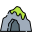 | Пещера слепых жаб | Cave | `cave` |
| 4 |  | Ангар | Shed | `shed` |
| 5 | 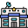 | Космическая база | Base | `base` |
| 6 |  | Луна Тамби | Moon | `space` |
| 7 |  | Комплекс | Comp | `comp` |
| 8 |  | Замок | Castle | `castle` |

Названия и порядок в меню одинаковы в игре и редакторе.

Для Луны сохранено исходное имя файлов `space`.

Переименовывать карты не требуется.

## Предметы: ровно 10 видов

&nbsp;

| Иконка | Предмет | Где искать | Назначение |
| :---: | :--- | :--- | :--- |
| 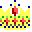 | **Корона Эпох** (*Crown / Crown of the Ages*) | Замок (Castle), 1-й экран | Главное сокровище; в этом порте запускает финал. |
| 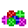 | **Самоцветы** (*Gems*) | Луна Тамби (Moon), 3-й экран | Главное сокровище. |
| 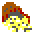 | **Мешок золота** (*Gold*) | Пещера слепых жаб (Cave), 2-й экран в текущих картах | Главное сокровище. |
|  | **Ключ от двери** (*Door Key*) | Скалистый лес (Forest), 3-й экран | Открывает запертые двери. |
| 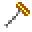 | **Штопор** (*Corkscrew*) | Космическая база (Base), 2-й экран | Огненные шары летят по волне. |
| 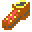 | **Ботинки** (*Boots*) | Космическая база (Base), 3-й экран | Увеличивают высоту прыжка. |
| 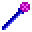 | **Жезл телепортации** (*Teleport Wand*) | Пещера слепых жаб (Cave), 3-й экран в текущих картах | Позволяет телепортироваться. |
| 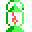 | **Фонарь** (*Lantern*) | Комплекс (Comp / Tube), конец 3-го экрана | Освещает тёмные помещения. |
| 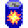 | **Бластер-кола** (*Blastola Cola*) | Пять банок; расположение ниже | Даёт оружие и увеличивает число одновременных выстрелов до пяти. |
|  | **Щит** (*Shield*) | Встречается в разных локациях | Восстанавливает энергию щита; при полной шкале даёт дополнительную жизнь. |

- **Главные сокровища:** Корона Эпох, Самоцветы, Мешок золота.
- **Снаряжение и улучшения:** Ключ, Штопор, Ботинки, Жезл телепортации, Фонарь.
- **Оружие и восстановление:** Бластер-кола и Щит.

В текущем порте взятие короны запускает пересчёт оставшихся жизней в очки и финал, даже если остальные сокровища не собраны.

### Пять банок бластер-колы

1. **Скалистый лес (Forest)**, 1-й экран — прямо на старте.
2. **Озеро Сири (Lake)**, 1-й экран.
3. **Озеро Сири (Lake)**, 3-й экран — перед входом в шаттл.
4. **Луна Тамби (Moon)**, 1-й экран.
5. **Ангар (Shed)**, 2-й экран.

Дополнительная жизнь даётся также за каждое найденное сокровище и каждые
50 000 очков. Пять банок колы — пять экземпляров одного вида предмета.

В `assets/dos/world.json` золото размещено во 2-й панораме пещеры,
а жезл телепортации — в 3-й. Таблица выше соответствует этим данным.

### Все щиты (Shields): 11 экземпляров

<p>
  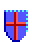
  &nbsp;&nbsp;<strong>Щит</strong> восстанавливает энергию до полной шкалы.<br>
  &nbsp;&nbsp;Если шкала уже полная, подбор щита даёт дополнительную жизнь (с учётом игрового предела жизней).
</p>

В `assets/dos/world.json` задано **11 щитов в 8 локациях**. В Ангаре, Комплексе и Замке — по два, в остальных пяти локациях — по одному.

| № | Локация | Экран | Ориентир | Координаты x, y |
|---|---|:---:|---|---|
| 1 | **Скалистый лес (Forest)** | 2 | Около середины панорамы, на уступе у разрыва между платформами. | 944, 80 |
| 2 | **Озеро Сири (Lake)** | 2 | Правее середины панорамы, на высокой платформе над водой. | 1424, 80 |
| 3 | **Луна Тамби (Moon)** | 2 | В первой половине панорамы, на коричневой платформе над поверхностью. | 912, 64 |
| 4 | **Космическая база (Base)** | 1 | У самого правого края, на верхнем уровне; от входа нужно идти направо. | 2016, 32 |
| 5 | **Пещера слепых жаб (Cave)** | 1 | На высоком уступе в левой части, рядом с внутренней дверью пещеры. | 328, 48 |
| 6 | **Ангар (Shed)** | 1 | За высокой стеной в правой части; для прохода пригодится телепорт. | 1296, 96 |
| 7 | **Ангар (Shed)** | 3 | В конце панорамы, справа от двери в Комплекс. | 1968, 80 |
| 8 | **Комплекс (Comp)** | 1 | Под потолком, на верхней платформе над большим разрывом; доступ через верхние платформы и телепортацию. | 1120, 16 |
| 9 | **Комплекс (Comp)** | 2 | В первой трети панорамы, на среднем уровне у края горизонтальной платформы. | 560, 80 |
| 10 | **Замок (Castle)** | 2 | В первой трети панорамы, на нижнем уровне. | 528, 112 |
| 11 | **Замок (Castle)** | 3 | В начале панорамы, на среднем уровне перед книжными шкафами текущей карты. | 352, 64 |

- Координаты даны в пикселях относительно левого верхнего угла отдельной панорамы 2048×160.
- Экраны 1–3 соответствуют файлам `0.PT`–`2.PT`.

---
## Бестиарий (противники)

| Иконка | Название врага | Перевод / Описание | Где встречается |
| :---: | :--- | :--- | :--- |
| 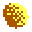 | **Space Pollen** | Космическая пыльца | Луна Тамби (Moon) |
| 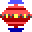 | **Saucer** | Летающая тарелка | Луна Тамби (Moon) |
| 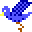 | **Brave Bird** | Храбрая птица | Скалистый лес, Ангар, Замок |
| 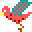 | **Shy Bird** | Пугливая птица (атакует со спины) | Скалистый лес (Forest) |
| 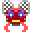 | **Bug-Eyes** | Пучеглаз (прыгает по земле) | Озеро Сири (Lake) |
| 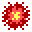 | **Fireball** | Огненный шар | Озеро Сири (Lake) |
| 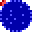 | **Glow Globe** | Светящийся шар (катится по полу) | Космическая база (Base) |
| 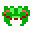 | **Blind Toad** | Слепая жаба | Пещера слепых жаб (Cave) |
| 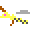 | **Killer Bee** | Пчела-убийца | Пещера слепых жаб, Ангар, Замок |
|  | **Beach Ball** | Пляжный мяч | Ангар, Замок |
| 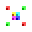 | **Atom** | Атом | Комплекс (Comp / Tube) |
|  | **Spark** | Искра | Комплекс (Comp / Tube) |
|  | **F.W. Bros.** | Братья-фейерверки | Комплекс (Comp / Tube) |
|  | **Spinner** | Спиннер (атакует, когда герой отвернулся)&nbsp;&nbsp;&nbsp;&nbsp; | Замок (Castle) |

---
## Хранение настроек и рекордов
Таблица рекордов (`scores.dat`) и настройки клавиш (`keys.cfg`) в первую очередь сохраняются в подкаталог **`data/`** рядом с исполняемым файлом (портативный режим). Если создать каталог `data/` и записать в него файл невозможно, используются системные пользовательские директории:

- **Linux:** `~/.local/share/CaptainComicLinux/CaptainComic/` (с учётом `XDG_DATA_HOME`);
- **Windows:** `%APPDATA%\CaptainComicWin\CaptainComic\`.

---
## Сборка и запуск

### Зависимости (Debian / Ubuntu / Kubuntu)
- **Для сборки под Linux:** `gcc`, `make` (4.3+), `pkg-config`, `python3`, `libsdl2-dev`, `libsdl2-ttf-dev`, `libsdl2-image-dev`.
- **Для Windows x64:** `mingw-w64` (`x86_64-w64-mingw32-gcc`) и SDK в `deps/win32/sysroot/`.
- **Для Linux standalone:** статические библиотеки в `deps/linux/` и системные зависимости Linux; MinGW-w64 не требуется.
- **Для архивов `.7z`:** `p7zip-full` (команда `make dist-7z`).

Для пересборки локальных Linux-библиотек также нужны:

- **`cmake`, `libfreetype-dev`, `libharfbuzz-dev`, `libpng-dev`, `libjpeg-dev` и `libbz2-dev`**.

Команда bash:

```bash
sudo apt install gcc make pkg-config python3 libsdl2-dev libsdl2-ttf-dev libsdl2-image-dev
```

&nbsp;

### Цели `Makefile`

| Команда | Результат | Описание |
| :--- | :--- | :--- |
| `make` *(или `make linux`)* | `captain-comic` | Обычная сборка для текущей Linux-системы |
| `make all` | 4 варианта | Linux и Windows: обычные и со встроенными ресурсами |
| `make linux` | `captain-comic` | Динамическая сборка под Linux (системные SDL2-библиотеки и внешний пакет ресурсов) |
| `make linux-standalone` | `captain-comic-standalone` | ELF со статическими SDL2, SDL2_ttf, SDL2_image и встроенными ресурсами; системные библиотеки остаются динамическими |
| `make static` | `captain-comic-static` | Совместимое имя для копии `captain-comic-standalone`; повторной компиляции нет |
| `make win` | `captain-comic.exe` + `data/*.dll` | Сборка под Windows x64 с отложенной загрузкой DLL из `data/` и вшитой иконкой |
| `make win-standalone` | `captain-comic-standalone.exe` | Единый автономный `.exe` под Windows x64 со статическим SDL2 и вшитыми ресурсами |
| `make data/assets.pak` | `data/assets.pak` | Упаковка каталога `assets/` в сжатый ZIP-архив ресурсов (`miniz`) |
| `make src/assets_data.h` | `src/assets_data.h` | Генерация C-массива `assets_pak` из `data/assets.pak` для standalone-сборок |
| `make dist` | Архивы в `dist/` | Сборка 4 вариантов и упаковка 5 дистрибутивов (включая совместимое имя `static`) (`.tar.gz` для Linux и `.zip` для Windows) с документацией и изображениями в `doc/` |
| `make dist-7z` | Архивы `.7z` в `dist/` | Сборка и упаковка дистрибутивов со сжатием Windows-сборок в `.7z` (алиас `make dist WIN_FMT=7z`) |
| `make web` | `build/web/` | Браузерная сборка WebAssembly через Emscripten |
| `make web-serve` | Локальный сервер | Сборка и запуск на `http://127.0.0.1:8080` |
| `make check` | Отчёт проверок | Сборка `linux` и запуск встроенного набора сценариев (`./captain-comic --self-test`) |
| `make check-input` | Проверка ввода | Реальный цикл SDL: короткие нажатия, движение, прыжок и стрельба |
| `make check-ending` | Проверка финала | Реальные события SDL: корона → пересчёт → заставка → ввод имени → таблица → выход |
| `make check-resources` | Проверка ресурсов | Каталог, внешний PAK, приоритет `--assets` и отклонение повреждённых ресурсов |
| `make clean` | — | Очистка сборки, дистрибутивов и генерируемых ресурсов; `keys.cfg` и `scores.dat` сохраняются |

Обе Linux-цели `linux-standalone` и `static` **не являются полностью статическими**: им по-прежнему нужны glibc, системные звуковые и оконные библиотеки. `static` сохранена только для совместимости со старыми командами.

Сборка инкрементальная; варианты используют отдельные объектные файлы, поэтому поддерживается `make -j4 all`. После изменения флагов компилятора выполните `make clean`. Генерация `assets.pak` воспроизводима и учитывает удаление ресурсов. Игровой бинарник содержит только распаковку ZIP; упаковку выполняет `tools/pack_assets.py`.

При необходимости пересобрать Linux-зависимости из включённых исходников:
```bash
sh deps/linux/deps.sh
```

### Быстрый старт (Linux)
```bash
make linux
./captain-comic
```

### Браузерная версия (WebAssembly)

Игра собирается из того же кода C11 / SDL2 с помощью Emscripten. Проверена сборка с Emscripten 7.0.0. Требуются активированное окружение Emsdk, `make` и Python 3; системные SDL2 для этой цели не нужны.

Установите Emsdk один раз (официальная [инструкция Emscripten](https://emscripten.org/docs/getting_started/downloads.html)):

```bash
git clone https://github.com/emscripten-core/emsdk.git "$HOME/emsdk"
"$HOME/emsdk/emsdk" install 7.0.0
"$HOME/emsdk/emsdk" activate 7.0.0
```

Затем в терминале с каталогом проекта подключите окружение и соберите игру:

```bash
source "$HOME/emsdk/emsdk_env.sh"
emcc --version
make web
make web-serve
```

Команду `source` нужно выполнять в каждом новом терминале. Если Emsdk установлен в другом каталоге, укажите его путь. Ошибка `emcc: Нет такого файла или каталога` означает, что компилятор не установлен либо не добавлен в `PATH`. Обычный GCC собирает Linux-версию; для `make web` нужен Emscripten.

Откройте `http://127.0.0.1:8080` и нажмите **Играть**. Результат сборки находится в `build/web/`: содержимое каталога можно разместить на статическом HTTP/HTTPS-хостинге. Открытие `index.html` через `file://` не поддерживается.

Управление рассчитано на компьютер с клавиатурой. Кнопки под игровым полем открывают справку, настройки, переключают звук, пополняют щит и включают полноэкранный режим. Звук запускается после нажатия **Играть**, при скрытии вкладки игра ставится на паузу.

Рекорды и назначение клавиш сохраняются в локальном хранилище браузера для текущего сайта. Они восстанавливаются после перезагрузки страницы; очистка данных сайта удаляет их. Если хранилище недоступно, страница показывает уведомление. Текущая игровая сессия не сохраняется.

### Версии для Windows x64
Кросс-сборка из Linux выполняется через **MinGW-w64** (`x86_64-w64-mingw32-gcc`) с вшиванием иконки (`src/icon.rc` → `assets/icons/icon.ico`) и флагом `-mwindows` (оконное приложение без консольного окна):
- **Обычная (`make win` → `captain-comic.exe` + `data/`):** использует отложенную загрузку DLL (`delayimp` + `tools/make_delaylib.py`), поэтому в корне лежит только `captain-comic.exe`, а все `.dll` и `assets.pak` находятся в `data/`.
- **Автономная (`make win-standalone` → `captain-comic-standalone.exe`):** один самодостаточный `.exe` со статическим SDL2 и вшитыми ресурсами (`src/assets_data.h`), не требующий внешних `.dll` и папок при запуске.

---

## Параметры командной строки

```bash
./captain-comic --version                      # версия сборки
./captain-comic --area lake --segment 1        # старт в выбранной локации (сегменты 0..2)
./captain-comic --assets /path/to/assets       # указать путь к каталогу ресурсов
./captain-comic --self-test                    # встроенные проверки физики, карт и логики
./captain-comic --headless --frames 10 --screenshot /tmp/shot.bmp
```

---

Ресурсы: обычная сборка ищет `data/assets.pak`, затем каталог `assets/` рядом с бинарником; standalone по умолчанию читает встроенный пакет. Явный `--assets PATH` в обоих случаях выбирает именно указанный каталог или PAK-файл и не подменяет отсутствующие файлы встроенными. Регистр имён ресурсов несущественен: поиск внутри каталога и PAK регистронезависимый. Имена всех файлов в `assets/dos/` приведены к нижнему регистру.

Финал обязательно запускается сразу после получения **Короны**, независимо от остальных сокровищ и снаряжения. После исчезновения героя оставшиеся жизни превращаются в очки (1000 за жизнь), затем показывается финальная заставка. Любая клавиша открывает рекорды; после ввода имени `Enter` сохраняет результат и показывает таблицу, а любая следующая клавиша закрывает игру. Если результат не попал в десятку, таблица показывается сразу, и любая клавиша закрывает игру. Состояние финала сбрасывается при новой игре.

В редакторе рекордов (`F4`, страница 4): стрелки вверх/вниз выбирают запись, ввод текста и Backspace меняют имя, стрелки влево/вправо меняют очки на 1000, с зажатым левым или правым `Shift` — на 10000 (×10), с `Ctrl` — на 100000 (×100; приоритет над `Shift`), `Ins` добавляет запись, `Del` удаляет. На цифровом блоке работают `Num 0 (Ins)` и `Num . (Del)` при выключенном Num Lock; при включённом Num Lock они используются для ввода текста. В заполненной таблице сначала удалите ненужную запись. Подсказки расположены двумя строками под таблицей: клавиши редактирования выделены жёлтым, глобальные `Tab`, `PgUp`, `PgDn` и `F4` — бирюзовым. Имена ограничены 16 символами UTF-8, очки — диапазоном 1–999999999. После изменения очков таблица пересортировывается, курсор остаётся на редактируемой записи.

## Структура проекта

- `web/` — страница запуска браузерной версии, стили и кнопки управления.

- `src/main.c` — инициализация SDL2, главный цикл 120 Гц, аргументы командной строки, полноэкранный режим.
- `src/engine.c` — физика движения, прыжки, столкновения, двери, телепорты, ИИ врагов.
- `src/input.c` — обработка ввода, очередь быстрых выстрелов, переназначение клавиш.
- `src/resources.c` — загрузка бинарных ресурсов (`.PT`, `.TT2`, `.SHP`, `.SPR`, `dos/world.json`) напрямую в память через `miniz` без временных файлов на диске.
- `src/render.c` — отрисовка игрового поля, HUD, заставок, меню `F4` и справки `F1`.
- `src/sound.c` / `src/sound_data.h` — синтез звука PC Speaker по таблицам PIT Revision 5.
- `src/scores.c` — таблица рекордов, редактор и ввод имён на русском языке.
- `src/save.c` — замена файла сохранения с учётом различий POSIX и Windows.
- `src/tests.c` — встроенные сценарии тестирования.
- `src/cc.h` / `src/miniz.c` / `src/miniz.h` / `src/assets_data.h` — общие структуры, распаковщик архивов и встроенные ресурсы.
- `assets/` — игровые уровни и графика (`dos/`), заставки (`intro/`), игровые иконки (`icons/`) и шрифт (`fonts/`).
- `doc/README.md` — описание игры, управление, ресурсы и сборка.
- `doc/WALKTHROUGH.md` — прохождение с названиями локаций и нумерацией экранов порта.
- `doc/CHANGELOG.md` — версии и история изменений.
- `doc/AUDIT.md` — технические проверки, результаты и ограничения.
- `doc/images/` — иллюстрации документации; остальные материалы зависимостей также находятся в `doc/`.
- `data/` — упакованный пакет `assets.pak`, рантайм-библиотеки Windows (`.dll`) и портативные сохранения (`scores.dat`, `keys.cfg`).
- `deps/` — локальные статические зависимости (`deps/linux/`) и sysroot для MinGW-w64 (`deps/win32/sysroot/`).
- `tools/` — вспомогательные скрипты сборки (`pack_assets.py`, `dist.py`, `make_delaylib.py`, проверки ввода и загрузки ресурсов).

---

## Происхождение и благодарности

- **Оригинальная игра:** *Adventures of Captain Comic* (Revision 5), Michael A. Denio.
- **Формат панорам и редактор уровней:** восстановлены с помощью **PANED 2.05** (Max Zhivluck, 1990–1991).

