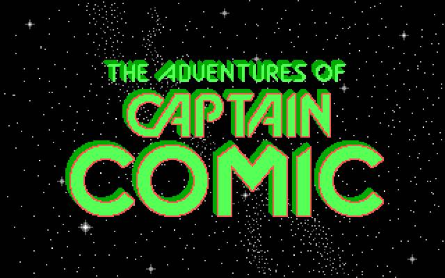
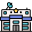
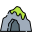

# Прохождение «The Adventures of Captain Comic» (PC / DOS)

	

Прохождение адаптировано из перевода руководства по **Captain Comic** *(версия для ПК)*: [GameFAQs — Guide and Walkthrough](https://gamefaqs.gamespot.com/pc/581707-captain-comic/faqs/64182), автор **ManiacMansionFan**, публикация **ArkadyRenko**.

Названия локаций и номера экранов приведены к этому порту. Экраны 1–3
соответствуют файлам `0.pt`–`2.pt`; на Луне используются файлы `space`.
В пещере жезл телепортации находится на экране 3, золото — на экране 2.
В этом порте получение **Короны Эпох** запускает финал независимо
от наличия остальных сокровищ.

---

## История DOS-оригинала

**The Adventures of Captain Comic** (более известная как просто **Captain Comic**) — видеоигра, созданная Майклом Денио и выпущенная в 1988 году для ПК по модели *shareware* (условно-бесплатно). В 1990 году вышло продолжение *Captain Comic II: Fractured Reality*, а также порт первой части на NES, который сильно отличается от ПК-версии. Для запуска DOS-оригинала на современных компьютерах используется эмулятор вроде **DOSBox**. Этот порт запускается напрямую, без эмулятора.

* **Версия 1 (май 1988):** Оригинальный релиз.
* **Версия 2 (ноябрь 1988):** Добавлена настройка клавиш, сброс таблицы рекордов, мелкие исправления.
* **Версия 3 (февраль 1989):** Переработано управление, исправлены серьезные баги.
* **Версия 4 (октябрь 1989):** Добавлена поддержка джойстика для некоторых ПК.
* **Версия 5 (июль 1991):** Исправлена работа джойстика для всех ПК, убрано начисление очков за падение за пределы экрана, изменена заглавная музыкальная тема. *(Прохождение написано именно для 5-й версии).*

---

## Цель игры

Капитан Комик должен вернуть три сокровища планеты Омсок (*Omsoc* — *Cosmo* наоборот), которые были украдены и спрятаны на далекой планете Тамби (*Tambi* — *IBM AT* наоборот): **Самоцветы (GEMS)**, **Мешок золота (GOLD)** и **Корону Эпох (CROWN)**.

В DOS-оригинале победа требует всех трёх сокровищ. В этом порте для запуска финала достаточно Короны Эпох. Потеря всех жизней завершает игру поражением. Жизнь теряется при попадании с уже пустой шкалой щита или при падении в пропасть.

---

## Предметы

* **SHIELD (Щит):** Полностью восстанавливает шкалу щита. Если шкала уже полная — дает дополнительную жизнь.
* **BLASTOLA COLA (Бластер-кола):** Каждая найденная банка позволяет выпускать на один огненный шар больше за раз (всего в игре 5 банок). В начале игры вы не можете стрелять, пока не подберете первую банку.
* **DOOR KEY (Ключ от двери):** Позволяет открывать двери и переходить в другие локации.
* **CORKSCREW (Штопор):** Меняет траекторию выстрелов с прямой на волнообразную. Позволяет поражать низких врагов, ползающих по земле.
* **BOOTS (Ботинки):** Позволяют прыгать немного выше, открывая доступ к новым местам.
* **TELEPORT WAND (Жезл телепортации):** Телепортирует вас в другую часть экрана, позволяя обходить препятствия и сложные участки с прыжками.
* **LANTERN (Фонарь):** Позволяет видеть в темных зонах.
* **GEMS, GOLD и CROWN (Самоцветы, Мешок золота и Корона Эпох):** Три главных сокровища оригинала; в этом порте Корона Эпох запускает финал независимо от остальных.

---

## Советы

* **Нет сохранений:** В игре нет сохранений и паролей, поэтому действуйте медленно и осторожно. Не пытайтесь пробежать уровень напролом, получая урон.
* **Постоянная стрельба:** Собрав несколько банок колы, нажимайте кнопку огня как можно чаще, даже если врагов не видно — они регулярно появляются в углах экрана.
* **Фарм жизней:** Дополнительная жизнь дается за каждое найденное сокровище, за подбор щита при полной шкале энергии и за каждые **50 000 очков**. Если жизней мало, встаньте в безопасном месте и отстреливайте врагов ради очков.
* **Нелинейность:** Игра нелинейна, поэтому запоминайте расположение дверей и развилок.

---

## Полное прохождение

### Оглавление

-  [Скалистый лес](#forest)
-  [Озеро Сири](#lake)
-  [Луна Тамби](#moon)
-  [Космическая база](#base)
-  [Пещера слепых жаб](#cave)
-  [Ангар](#shed)
-  [Комплекс](#comp)
-  [Замок](#castle)

---

###  Скалистый лес — экран 1 (forest – screen 1)

Вы появляетесь рядом с первой банкой **BLASTOLA COLA (1)**. Подберите её, чтобы начать стрелять. В дверь рядом зайти пока нельзя (нет ключа), да она и понадобится только в самом конце. Идите направо, отстреливая птиц или уворачиваясь от них. Перепрыгните пропасть по уступам и перейдите на следующий экран.

###  Скалистый лес — экран 2 (forest – screen 2)

Снова идите направо и перепрыгните пропасть по уступам — там лежит щит. Остерегайтесь птиц. Далее нужно будет попрыгать по веткам деревьев, чтобы пройти направо к следующему экрану.

###  Скалистый лес — экран 3 (forest – screen 3)

Продолжайте движение направо. Дойдя до уступов, заберитесь наверх и перепрыгните через них, чтобы найти **DOOR KEY (Ключ)**. Дверь прямо под ключом пока игнорируйте и идите дальше направо. Вскоре вы увидите еще одну дверь — откройте её.

###   Озеро Сири — экран 1 (lake – screen 1)

Идите налево и подберите вторую банку **BLASTOLA COLA (2)**. Осторожно продвигайтесь влево, отстреливая пучеглазов (*bug-eyes*) — эти прыгучие враги агрессивнее птиц и преследуют вас. Идите налево на следующий экран.

###   Озеро Сири — экран 2 (lake – screen 2)

Идите налево, уничтожая пучеглазов и огненные шары, отскакивающие от краев экрана. Перепрыгните несколько уступов, где лежит щит, и идите дальше налево.

###   Озеро Сири — экран 3 (lake – screen 3)

Сразу заберитесь по уступам на самый верх экрана и двигайтесь налево по верхним платформам. Сначала расстреливайте врагов, и только потом прыгайте. На широких провалах зажимайте кнопку прыжка для максимальной дальности. Подберите третью банку **BLASTOLA COLA (3)** и зайдите в космический шаттл.

###   Луна Тамби — экран 1 (moon – screen 1)

Из-за низкой гравитации вы прыгаете здесь выше обычного. Прямо на старте лежит четвертая банка **BLASTOLA COLA (4)**. Стреляйте чаще, расчищая путь и набирая очки. Идите направо, уничтожая космическую пыльцу. Внимательно смотрите под ноги: мелкие ямы сливаются с фоном. Вскоре встретится огромная пропасть с белой галактикой на фоне. Прыгать нужно с самого края на самый край, зажав кнопку прыжка до приземления. Идите направо.

###   Луна Тамби — экран 2 (moon – screen 2)

Двигайтесь направо, перепрыгивая небольшие ямы. Вскоре вы найдете щит и увидите коричневые платформы. Прыгайте по ним и опасайтесь летающих тарелок — они отскакивают от границ экрана и часто врезаются в игрока. Переходите направо.

###   Луна Тамби — экран 3 (moon – screen 3)

Идите направо, отбиваясь от множества летающих тарелок. После серии прыжков вы найдете первое сокровище — **GEMS (Самоцветы)**. Сразу после этого войдите в Космическую базу.

###   Космическая база — экран 1 (base – screen 1)

Здесь водятся пучеглазы и светящиеся шары (*glow globes*) — синие сферы, катящиеся по полу. Обычные выстрелы их не берут, так как они слишком низкие. Если шар мешает, отойдите назад за яму и дождитесь, пока он туда упадет.
Сразу запрыгните на верхнюю платформу и идите налево *(Примечание: если нужен щит, сначала пройдите немного направо, а потом вернитесь)*. Спуститесь по лестнице и идите налево, перепрыгивая ямы (по уступам прыгать безопаснее). У левого края экрана войдите в верхний или средний проход (нижний понадобится позже).

###   Космическая база — экран 2 (base – screen 2)

Идите налево. Вам встретятся ямы с низкими уступами прямо над ними. Не пытайтесь запрыгнуть на уступы — прыгайте через ямы по низу, учитывая, что потолок ограничивает высоту прыжка. В конце экрана вы найдете **CORKSCREW (Штопор)**. Теперь ваши выстрелы летят волной и убивают наземных врагов вроде светящихся шаров. Это отличное место, чтобы пофармить очки и дополнительные жизни на бесконечно появляющихся врагах. Когда будете готовы, вернитесь направо на предыдущий экран (до верхних дверей здесь не допрыгнуть).

###   Космическая база — экран 1 (2-й визит)

Сразу спрыгните на нижний уровень и вернитесь на предыдущий экран через самый нижний проход.

###   Космическая база — экран 2 (2-й визит)

Идите налево, перепрыгивая мелкие ямы, пока не дойдете до двери. Откройте её.

###   Космическая база — экран 1 (3-й визит)

Вы появитесь прямо под входной дверью базы. Идите направо, убивая врагов и перепрыгивая ямы, до другой двери. Откройте её.

###   Космическая база — экран 3 (base – screen 3)

Осторожнее с разрушенным полом: блоки с дырой посередине не твердые — вы провалитесь сквозь них. Идите направо, аккуратно прыгая с уступа на уступ. В правом конце экрана спрыгните на нижний уровень и идите налево — там лежат **BOOTS (Ботинки)**, увеличивающие высоту прыжка. Идите дальше налево и войдите в дверь.

###   Космическая база — экран 2 (3-й визит)

Вы выйдете из верхней двери. Теперь вам нужно попасть в среднюю дверь (либо аккуратно спланируйте туда при падении влево, либо спрыгните вниз и запрыгните обратно — с новыми ботинками высоты хватит).

###   Озеро Сири — экран 3 (2-й визит)

Вы окажетесь слева от космического шаттла (раньше путь сюда преграждала высокая стена). Идите налево и войдите в новую дверь.

###   Пещера слепых жаб — экран 1 (cave – screen 1)

Запомните, как выглядит дверь, из которой вы вышли — в пещерах двери плохо различимы на фоне стен. Новые враги здесь — слепые жабы (прыгают дальше и быстрее пучеглазов) и пчелы-убийцы. Пчелы зависают прямо над вами и пикируют вертикально вниз. Так как стрелять вверх нельзя, отходите в сторону, подпрыгивайте и расстреливайте их.
Идите направо. Вскоре наверху вы увидите дверь и щит — не берите щит без крайней нужды, он пригодится на обратном пути. Продолжайте идти направо, заберитесь на верхние уступы и дойдите до следующей двери. Откройте её.

###   Пещера слепых жаб — экран 3 (cave – screen 3)

Идите налево. Миновав статую, вы попадете на серию узких платформ над пропастью. Здесь можно перепрыгивать через одну платформу за раз, чтобы совершать меньше прыжков и снизить риск падения. Далее вы найдете **TELEPORT WAND (Жезл телепортации)**. Потренируйтесь им пользоваться и идите налево.
*(Примечание: если вы умрете на этом экране после взятия жезла телепортации, при возрождении сразу выйдите в дверь назад, идите налево и зайдите в ту первую дверь со щитом, которую мы пропускали — она ведёт в то же место на 2-м экране).*

###   Пещера слепых жаб — экран 2 (cave – screen 2)

Спрыгните вниз. Дверь пока не открывайте. Слева вы увидите второе сокровище — **GOLD (Мешок золота)**. Используйте жезл телепортации, чтобы добраться до него и забрать. Затем вернитесь вниз и откройте дверь.

###   Пещера слепых жаб — экран 1 (2-й визит)

Вы выйдете из той самой двери со щитом. Подберите щит и возвращайтесь налево к выходу из пещеры. При первом прыжке назад сначала спрыгните на маленькую платформу ниже, иначе рискуете сорваться в пропасть. Дойдя до двери, выходите.

###   Озеро Сири — экран 3, 2 и 1 (3-й / 2-й визит)

Теперь вам предстоит долгий путь в самый правый край локации с озером. Пройдите направо через 3-й и 2-й экраны. На 1-м экране озера проигнорируйте дверь, из которой вы изначально пришли из леса, и идите правее до постройки с другой дверью. Войдите в неё.

###   Ангар — экран 1 (shed – screen 1)

Здесь водятся птицы, пчелы и пляжные мячи (агрессивные прыгающие враги). Идите направо. Вы встретите цветные блоки над пропастью, серию мелких ям и стену — преодолевайте всё это с помощью жезла телепортации. За стеной вас ждет щит. Далее перепрыгните фиолетовые блоки и идите направо.

###   Ангар — экран 2 (shed – screen 2)

Идите направо, чередуя прыжки и телепортацию. Поднявшись по большой лестнице, телепортируйтесь через две широкие пропасти. Затем начнется сложный участок: нужно пройти по верху экрана, прыгая со столба на столб. Жезл телепортации здесь использовать нельзя — он телепортирует вас вниз на пол, откуда придется начинать заново. Пропрыгав по столбам до конца, вы увидите наверху дверь и пятую, последнюю банку **BLASTOLA COLA (5)**. Телепортируйтесь туда и заберите её (здесь также удобно фармить очки, расстреливая врагов сквозь стену). Войдите в дверь.

###   Ангар — экран 3 (shed – screen 3)

Идите направо, преодолевая цветные блоки с помощью прыжков и телепортации. В конце пути подберите щит и войдите в дверь.

###   Комплекс — экран 1 (comp – screen 1)

Идите направо по извилистому пути. Вскоре вы дойдете до широкой пропасти, ограниченной стенами, со щитом на верхнем правом уступе. Поднимитесь на верхнюю платформу слева и сделайте затяжной прыжок вправо, игнорируя крошечную платформу посередине пропасти (приземляться на нее не нужно, вы долетите сразу до правого края). Чтобы забрать щит, встаньте на левый край площадки, куда приземлились, телепортируйтесь на ту самую центральную платформу, запрыгните за щитом и телепортируйтесь обратно. Идите направо на следующий экран.

###   Комплекс — экран 2 (comp – screen 2)

Двигайтесь направо, активно используя жезл телепортации на сложных прыжках.

###   Комплекс — экран 3 (comp – screen 3)

Снова идите направо, помогая себе телепортацией. В конце экрана вы найдете **LANTERN (Фонарь)**, позволяющий видеть в темноте. Подобрав его, сделайте длинный прыжок на платформу справа и войдите в дверь.

###   Скалистый лес — экран 3, 2 и 1 (2-й визит)

Вы вернетесь в лес через дверь под тем местом, где брали ключ. Пройдите налево через все три экрана леса до самого начала игры и войдите в первую дверь.

###   Замок — экран 1 (castle – screen 1)

Это темная зона: без фонаря здесь была бы кромешная тьма, но с фонарем в инвентаре всё отлично видно. Прямо над вами висит Корона, но телепортироваться к ней нельзя. Идите налево (это финальная и самая сложная локация). Перепрыгивайте и перелетайте телепортом ямы по нижнему уровню, но после первой серии провалов заберитесь на верхние уступы, чтобы пройти дальше. Пробиваясь сквозь толпы врагов, дойдите до двери и войдите в неё.

###   Замок — экран 2 (castle – screen 2)

Вам нужно попасть в дверь наверху, но жезл телепортации до неё не достанет. Идите направо, уничтожая новых врагов — спиннеров (просто подпрыгивайте и стреляйте). В правом конце экрана заберитесь на уступ и идите по верхнему ярусу обратно налево. Не падайте вниз и не используйте телепорт, иначе окажетесь внизу и придется начинать путь заново. Ближе к концу будет несколько длинных прыжков — прыгайте с самого края и зажимайте кнопку прыжка. Войдите в верхнюю дверь.

###   Замок — экран 3 (castle – screen 3)

Сделайте большой прыжок через первую яму и двигайтесь направо через толпы врагов. В конце пути войдите в дверь.

###   Замок — экран 1 (2-й визит)

Подберите **CROWN (Корону Эпох)**. Поздравляем, вы прошли *Captain Comic*!

В порте оставшиеся жизни превращаются в очки, затем показывается конечная
заставка. Любая клавиша открывает рекорды: ввод имени при попадании в десятку
или сразу таблицу. После показа таблицы следующая клавиша закрывает игру.

---

## Возможный короткий путь в DOS-версии

В исходном руководстве обсуждается обход: войти в Комплекс через дверь
в Скалистом лесу и сразу телепортироваться к Фонарю, пропустив Ангар
и пятую банку колы. Руководство не подтверждает этот приём для Revision 5:
пропасть описана как слишком широкая для жезла телепортации. Основной маршрут выше
не использует этот обход.

В этом порте жезл телепортации переносит героя в направлении взгляда, в пределах
текущей панорамы; для телепортации нужно стоять на опоре, а в месте
назначения должно быть свободное пространство. Обход исходной игры
не следует считать проверенным способом прохождения порта.
